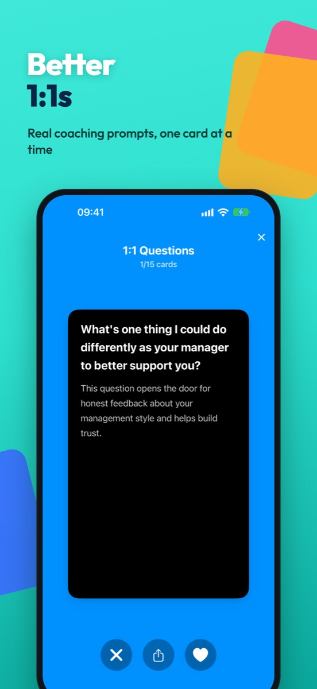
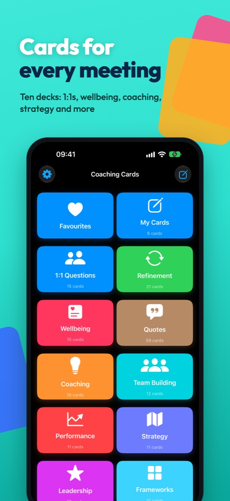
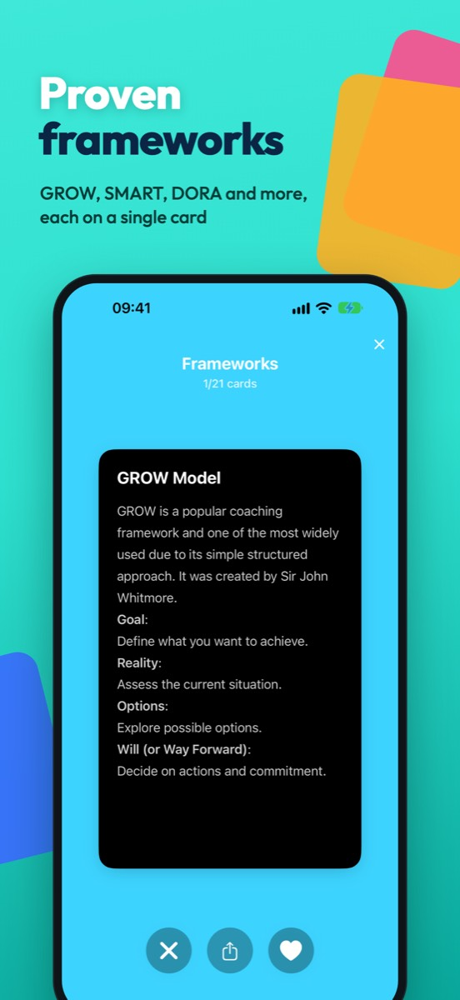

  

<h1 align="center">EngMan: Coaching Card Decks for Engineering Managers</h1>

  <strong>Better conversations, one card at a time.</strong> 
  <a href="https://engman.thechels.uk/">engman.thechels.uk</a> ·
  <a href="https://apps.apple.com/gb/app/engman-em-coaching-cards/id6747295473">Download free on the App Store</a>

---

**EngMan** is an iPhone app of 200 coaching cards for engineering managers: real prompts, questions and frameworks for 1:1s, feedback, retros, team building and stakeholder conversations. Swipe through scenario-based questions that go deeper than "how's it going?", built for managers who want better conversations, not more theory.

  
  
  

## Ten decks

| Deck | Cards | Access |
|---|---|---|
| 1:1 Questions | 15 | Free |
| Refinement | 21 | Free |
| Wellbeing | 15 | Free |
| Quotes | 59 | Free |
| Coaching | 18 | Premium |
| Team Building | 12 | Premium |
| Performance | 11 | Premium |
| Strategy | 11 | Premium |
| Leadership | 17 | Premium |
| Frameworks (GROW, SMART, DORA, SCARF, OODA and more) | 21 | Premium |

## Features

- Swipe right to save a card to your favourites, left to dismiss it.
- Write your own cards for your team.
- Share a single card as an image.
- Favourites sync across your devices with iCloud.
- Works offline: every deck lives on your phone.

## Pricing

Free to download. Annual subscription £3.99 a year, or lifetime access £14.99 one-off, unlocks every deck.

## Private by design

No account needed. Read the [privacy policy](https://thechels.uk/app/privacy).

## Requirements

- iPhone with iOS 18.5 or later

More about EngMan: [thechels.uk/projects/engman](https://thechels.uk/projects/engman).
